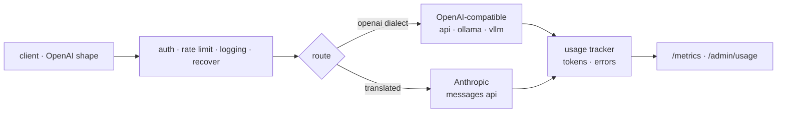

# keystone

[](https://github.com/edxeme/keystone/actions/workflows/ci.yml)
[](https://pkg.go.dev/github.com/edxeme/keystone)
[](LICENSE)

**A minimal OpenAI-compatible gateway for LLM providers.** One
endpoint, many upstreams, fallback chains, streaming end-to-end and
per-key token accounting. ~1,200 lines of dependency-light Go.

In architecture, the keystone is the stone that locks the arch and
routes its load. This does the same for LLM traffic.

## Why

Every project I touch ends up gluing the same pieces: a client that
speaks OpenAI shape, a second provider with a different dialect, keys
in the environment, a fallback when one endpoint is down, and a vague
suspicion about who is burning how many tokens. keystone is that glue
done once: a small binary you can point at Ollama locally and at
hosted providers in production, without a dependency pile.

## Quickstart

```bash
go install github.com/edxeme/keystone/cmd/keystone@latest
keystone --config config.example.yaml
```

```bash
# what clients see: a plain OpenAI endpoint
curl localhost:8080/v1/chat/completions \
  -H "Authorization: Bearer sk-local-dev-1" \
  -H "Content-Type: application/json" \
  -d '{"model":"qwen2.5-coder:7b","messages":[{"role":"user","content":"hi"}]}'
```

The request routes to Ollama when configured; asking for
`claude-sonnet-4-5` translates to the Anthropic Messages API — system
message split, `max_tokens` defaulted, stop reasons mapped. If the
first upstream in the chain fails, the next one serves the request.

Streaming works end-to-end: upstream SSE is translated to OpenAI
chunks on the fly (Anthropic `content_block_delta` →
`choices[0].delta`), including the role chunk and `[DONE]`.

## Configuration

```yaml
listen: :8080
api_keys: [sk-local-dev-1]        # [] = auth off (local dev)
upstreams:
  - name: local
    provider: openai              # Ollama-compatible
    base_url: http://localhost:11434/v1
  - name: anthropic
    provider: anthropic
    api_key_env: ANTHROPIC_API_KEY
routes:
  "gpt-4o": [openai, local]       # fallback chain
  "claude-sonnet-4-5": [anthropic]
rate_limit:
  requests_per_minute: 120        # per key; 0 disables
```

Full example in [config.example.yaml](config.example.yaml).

## Endpoints

| Route | Method | Purpose |
| :--- | :--- | :--- |
| `/v1/chat/completions` | POST | chat, streaming and not |
| `/v1/models` | GET | routed models, OpenAI list shape |
| `/healthz` | GET | liveness |
| `/metrics` | GET | Prometheus text format |
| `/admin/usage` | GET | accounting table as JSON |

Usage rows are keyed by (client key, model, upstream). Token counts
come from upstream usage fields when reported, and from a rough
length-based estimate when not — good enough for cost curiosity,
explicitly not for billing.

## Architecture



## Design notes

- **Canonical dialect at the edge.** Everything inside the gateway is
  OpenAI shape; provider quirks die at the upstream boundary.
- **Failover only before first byte.** A stream that already reached
  the client cannot be re-routed; it terminates with an error event
  instead. Honest over clever.
- **stdlib-first.** `net/http`, `encoding/json`, `log/slog`, hand-rolled
  SSE — the only module dependency is the YAML parser.
- **Accounting is in memory.** No state store; the process is the
  unit of deployment and of billing curiosity.

## Roadmap

- [ ] Retry budgets with jittered backoff for non-streaming calls
- [ ] Token-accurate counting per provider
- [ ] Per-key quotas with soft warnings
- [ ] Config hot reload

## License

[MIT](LICENSE) © Edwin Martínez
